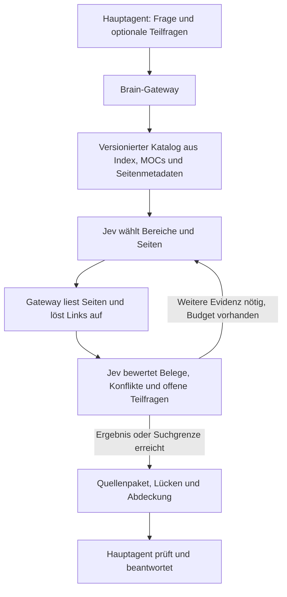

# Jev als Suchdienst für das Second Brain

Stand: 2026-09-19. Architekturprüfung und Umsetzungsvorschlag; noch keine neue Suchimplementierung.
Arbeitsmodus: `efficient`. Grundlage: aktueller Code, bestehende Versuchsberichte,
frisch abgerufene TypeSafe-Dokumentation und lokale Reproduktionen.

**Empfehlung:** Jev soll die Navigation vom Katalog bis zu belegten Seiten innerhalb
eines einzigen Gateway-Aufrufs steuern. Der Hauptagent formuliert den Informationsbedarf
und verarbeitet das Ergebnis. Die Suchschleife bleibt im Dienst. Die jetzige Integration
ist dafür eine brauchbare technische Grundlage, delegiert aber zu wenig von der Suche.
Eine Kosten- oder Qualitätsverbesserung dieser neuen Architektur ist noch nicht gemessen.

## 1. Was heute tatsächlich passiert

| Befund | Beleg im aktuellen Code | Auswirkung |
|---|---|---|
| `navigate` beginnt mit lexikalischen Kandidaten, standardmäßig zwölf. | `scripts/bsb_jev_navigation.py:207`, `scripts/bsb_jev_focus.py:626`, `:661`, `:687` | Jev entscheidet erst nach der Vorauswahl. |
| Nur die ursprüngliche Frage bestimmt diese Vorauswahl; `needs` fließen dort nicht ein. Seiten ohne Wortüberschneidung werden ausgeschlossen. | `scripts/bsb_jev_focus.py:635`, `scripts/bsb_jev.py:493` | Semantisch passende Seiten können für Jev unsichtbar bleiben. |
| Jev erhält lexikalisch ausgewählte Fenster von höchstens 2.048 Bytes pro Seite. | `scripts/bsb_jev_focus.py:40`, `:185` | Das ist keine semantische Prüfung der ganzen Seite. |
| Weitere Links werden beim Vollseitenlesen durch den Aufrufer entdeckt. `next` bewertet verlinkte und zurückgestellte Seiten erneut. | `scripts/bsb_jev_navigation.py:187`, `:223` | Der teure Agent organisiert weiterhin die Leseschritte. Eine neue offene Teilfrage startet keine neue katalogweite Suche. |
| `advise placement/link` verwendet denselben allgemeinen Suchpfad mit anderem Operationsnamen. | `scripts/bsb_jev.py:534` | Es fehlen eigene Entscheidungen über Zielabschnitt, Beziehungstyp und Belegstelle. |
| Die normale Navigation entfernt nur `excerpts`; Bewertungen und wiederholte Metadaten bleiben enthalten. | `scripts/bsb_jev_navigation.py:130`, `scripts/bsb_jev_focus.py:585` | Die Aussage in `docs/jev.md`, Verteilungen blieben ausschließlich lokal, trifft derzeit nicht vollständig zu. |
| Ein Fenstertext steht zweimal im Jev-State: unter `windows` und als zusammengefügtes `text`. | `scripts/bsb_jev_focus.py:352` | Vermeidbare Eingabegröße und frühere Aufteilung in mehrere Requests. |

Die Begrenzung auf 24 KiB pro Request ist eine lokale Gateway-Entscheidung
(`scripts/bsb_jev.py:54`), keine TypeSafe-Kontextgrenze. Einfach größere Pakete zu
senden löst jedoch die falsche Vorauswahl und die zusätzlichen Agentenrunden nicht.

Zu behalten sind Hashprüfungen, nachvollziehbare Lesesitzungen, zurückgestellte Kandidaten,
Schreibpläne mit Quellenbezug, Backlinkprüfung und Rollback. Insbesondere darf ein
negatives Jev-Urteil kein Beweis sein, dass im gesamten Brain nichts vorhanden ist.

## 2. Was TypeSafe dafür ermöglicht

Jev erzeugt strukturierte Entscheidungen über gelieferten Text. Anwendungscode liest
Dateien, führt Aktionen aus und hält den Suchzustand. Damit kann eine Anwendung sich
agentenartig durch Wissen bewegen, obwohl Jev selbst weder Dateien öffnet noch freie
Suchtexte oder Zusammenfassungen generiert. [Bauanleitung](https://docs.typesafe.ai/concepts/how-to-build-with-system-one),
[Function Calling](https://docs.typesafe.ai/cookbooks/function_calling).

| Aufgabe | Passender Baustein | Übertragung auf das Brain |
|---|---|---|
| Aus einem Katalog passende Einträge auswählen | Breite Auswahl, danach Detailprüfung | Index/MOC-Beschreibungen zuerst, Seiten danach. [Skill Suggestion](https://docs.typesafe.ai/cookbooks/skill_suggestion) |
| Durch Bereiche navigieren | Hierarchische Choices mit mehreren weiterverfolgten Pfaden | Bei Mehrdeutigkeit alternative Bereiche erhalten. [Hierarchical Classification](https://docs.typesafe.ai/cookbooks/hierarchical_classification) |
| Eine Belegstelle finden | Choice über Abschnitts-/Zeilen-IDs und separate Noul-Frage zur Antwortabdeckung | Originaltext per ID auslesen; keine erfundene Zusammenfassung. [Semantic Find](https://docs.typesafe.ai/cookbooks/semantic_find) |
| Mehrere passende Seiten erkennen | Eigenständiger Noul oder Score pro Kandidat | Eine einzelne Choice bedeutet nicht, dass alle anderen Seiten irrelevant sind. [Noul](https://docs.typesafe.ai/primitives/noul), [Score](https://docs.typesafe.ai/primitives/score) |
| Evidenz und Gegenbelege unterscheiden | Getrennte Fragen über Relevanz und Widerspruch | Konflikte sichtbar an den Hauptagenten geben. [RAG Passages](https://docs.typesafe.ai/cookbooks/classifying_rag_passages) |
| Verknüpfungen und mögliche Dubletten prüfen | Urteile über konkrete Seitenpaare | Vorschlag mit Beziehungstyp und Belegstellen. [Entity Alignment](https://docs.typesafe.ai/cookbooks/entity_alignment) |
| Aussagen gegen Quellen prüfen | Exakter Zitatabgleich in Code, semantische Prüfung durch Jev | Zusätzliche Prüfung vor einem Schreibplan. [Citation Check](https://docs.typesafe.ai/cookbooks/citation_check) |

Choice-Wahrscheinlichkeiten vergleichen konkurrierende Optionen innerhalb einer Frage.
Sie sind keine unabhängigen Relevanzwerte und sollten nicht ungeprüft über verschiedene
Katalogpakete verglichen werden. Noul liefert eine Ja-Wahrscheinlichkeit; Score bewertet
anhand beschriebener Stufen. Schwellen müssen am Brain geprüft werden.
[Primitives](https://docs.typesafe.ai/primitives), [Confidence](https://docs.typesafe.ai/confidence).

Die Cookbook-Ergebnisse sind Beispiele, teilweise mit Jev 1.12. Sie belegen weder die
Qualität auf unseren Daten noch eine garantierte Einsparung. Das Skill-Beispiel beschreibt
auch falsche Empfehlungen; die Hierarchie-Demo umfasst nur vier Beispiele.

## 3. Zielarchitektur

**Der vollständige Katalog ist der Einstieg.** Dieser Checkout hat 38 Markdown-Seiten
mit zusammen 131.506 Bytes, zwei MOCs und einen 6.278 Bytes großen Index. Für diese
Größe zuerst alle kompakten Seitendeskriptoren berücksichtigen; eine komplizierte
mehrstufige Hierarchie ist hier nicht zwingend nötig. Bei Wachstum nach thematischen
MOCs aufteilen. Ordner wie `concepts` und `sources` sind Seitentypen, keine geeignete
alleinige Themenhierarchie.

Der Katalog enthält stabile IDs, Titel, Aliase, Tags, Überschriften, vorhandene
Indexbeschreibungen, ausgehende/eingehende Links und Dateihashes. Keine neu erfundenen
Zusammenfassungen. Jede zulässige Seite wird erfasst; nicht im Index vertretene Seiten
erhalten einen expliziten Restbereich. Fehlende oder mehrdeutige Links bleiben sichtbar.
Nach Änderungen werden betroffene Einträge und davon abhängige Caches invalidiert.

**Jev navigiert; der Dienst arbeitet.** Der Hauptagent ruft etwa
`brain.find(question, needs?)` auf. Standardmäßig reicht die ursprüngliche Frage;
für komplexe Aufgaben kann der Agent in seinem ohnehin nötigen Turn Teilfragen ergänzen.
Es gibt keinen obligatorischen zusätzlichen Modellaufruf nur zur Zerlegung.
Der Dienst wählt passende Bereiche, lädt Seiten und verfolgt Links ohne zwischenzeitliche
Rückgabe an das Hauptmodell. Lexikalische Suche bleibt als zusätzlicher Kandidatenweg
erhalten, darf aber semantische Katalogkandidaten nicht durch einen frühen Top-12-Schnitt
verdrängen. Exakte Pfade, Titel und URLs laufen weiterhin deterministisch.

Pro Schritt sieht Jev genug Originaltext, um die konkrete Frage zu beurteilen. Große
Seiten werden an Überschriften segmentiert; Fundstellen behalten ihren umgebenden Abschnitt.
Unabhängige Fragen über denselben State werden gemeinsam geschickt. Abhängige Schritte
folgen erst nach dem Laden neuer Evidenz. Mehr Fragen sind nicht tokenfrei.
[Batching](https://docs.typesafe.ai/patterns/fan-out).

**Der Suchzustand bleibt intern.** Er enthält besuchte Bereiche, offene Teilfragen,
Belegstellen, Konflikte, zurückgestellte Alternativen und verbleibende Budgets.
Jev wählt ausschließlich aus angebotenen IDs/Aktionen. Code validiert diese gegen den
aktuellen Katalog und begrenzt Requests, Zeit und Bytes. Bei Lücken werden alternative
Bereiche und Nachbarn geprüft; nach Budgetende kommt `partial` oder `unresolved` zurück.
Die Auswahl muss mehr als einen Themenpfad zulassen. Eine niedrige Existenzbewertung
bezieht sich ausschließlich auf den untersuchten Text.

**Die Antwort an den Hauptagenten bleibt klein und überprüfbar.** Vorgeschlagene Felder:
`session_id`, `status`, `pages`, `evidence_refs`, `conflicts`, `unresolved_needs`,
`coverage`, `usage`. Referenzen enthalten Pfad, Abschnitt/Zeilen und Hash.
Bewertungsverteilungen, interne Kataloge und wiederholte Quelltexte bleiben lokal.
Bereits gelieferte Seiten werden in Folgerunden nicht automatisch erneut gesendet.

Die bestehende Projektregel verlangt vollständiges Lesen der ausgewählten Seiten.
Die erste Umsetzung liefert deshalb wenige vollständige Belegseiten. Ein Modus, in dem
der Hauptagent ausschließlich Auszüge sieht, wäre eine eigene, ausdrücklich zu prüfende
Änderung der Leseregel; er ist nicht stillschweigend Bestandteil dieses Vorschlags.
Das automatische Vollseitenlesen durch den Dienst ersetzt nicht die Prüfung durch den
antwortenden Agenten. Eine mögliche Einsparung würde durch weniger Suchrunden und weniger
unpassende Seiten entstehen.

## 4. Ablage, Verknüpfung und weitere Anwendungen

`brain.place(content, provenance)` verwendet dieselbe Katalognavigation und liefert
vorhandene Zielseite, Zielabschnitt oder `new_page_needed`. Die semantische Entscheidung
geht an Jev; Dateinamenvalidierung, Schema und tatsächlicher Schreibvorgang bleiben im Code
bzw. beim schreibenden Agenten. Freie neue Seitentitel entstehen nicht aus Jev-Choices.

`brain.relate(page_id)` prüft zunächst begrenzt vorgeschlagene Seitenpaare. Unabhängige
Beziehungen wie `supports`, `contradicts` oder `related_topic` können gleichzeitig gelten;
ein einziges exklusives Label wäre dafür ungeeignet. Jeder Vorschlag referenziert Originaltext.
Entitätsidentität, thematische Ähnlichkeit und sachlicher Widerspruch sind verschiedene Fragen.
Kein unbeschränktes Vergleichen aller Seitenpaare bei jeder Anfrage.

Weitere sinnvolle Anwendungen: vorhandene Antwortbelege vor externer Recherche erkennen,
neue Quellen den betroffenen Seiten zuordnen, mögliche Dubletten vor dem Anlegen erkennen
und Aussagen nach einer Quellenänderung zur erneuten Prüfung priorisieren. Jev darf dabei
reine Rechenarbeit, Versionsvergleich oder exakten Zitatabgleich nicht ersetzen.

## 5. Suche tatsächlich delegieren

Der lokale Status meldet aktuell `Enabled: False` und `Strict reads: False`.
Seine Anzeige `API Key: Missing` ist bei deaktiviertem Gateway irreführend:
`scripts/bsb_jev.py:960` überspringt dann das Laden des Schlüssels. Eine separate Prüfung
von `bool(load_api_key())` ergab **True**, ohne den Schlüssel auszugeben.
Zugangsdaten sind für den lokalen CLI-Prozess verfügbar; ihre Authentifizierung beim
Dienst wurde damit noch nicht getestet. Das separat laufende Harness-MCP ist erreichbar.

Für den Alltag braucht der Hauptagent einen einzigen verbindlichen Brain-Zugang.
Native Wiki-Suche, direkte Lesewege und Shell-Suchumwege müssen im jeweiligen Host
nachweislich abgefangen werden. Instruktionen allein belegen keine Durchsetzung.
Die vorhandenen Hooks sind dafür ein Ansatz, aber installierte Konfiguration beweist
keine aktive Interzeption. `docs/jev.md` nennt bisher einen echten Antigravity-Nachweis;
Codex und Claude wurden dort nur per Verträgen/Prozessen geprüft.

Zwei Betriebsformen müssen klar getrennt werden:

- **Kooperativer Agent im normalen Checkout:** aktive Hooks plus klare Anweisungen;
  bekannte Wrapper und alternative Werkzeuge müssen getestet werden.
- **Technisch isolierter Suchzugang:** nur der Gateway-Prozess hat Lesezugriff auf den
  Vault; der Antwortagent erhält Quellenpakete. Das erfordert getrennte Dateirechte oder
  Prozesse/Umgebungen. Ein MCP-Tool allein entzieht dem Agenten keinen Dateizugriff.

Der Index darf dem Agenten nicht weiterhin obligatorisch vollständig als Sucheinstieg
aufgeladen werden, wenn die Katalogsuche delegiert sein soll. Die bisherige Regel
„Read index first“ braucht für aktivierten Gateway-Betrieb eine gezielte Anpassung;
Schema und notwendige Arbeitsanweisungen bleiben verfügbar.
Bei Jev-Ausfall meldet das Gateway den Fehler oder nutzt einen benannten internen
Fallback. Der Agent beginnt nicht stillschweigend dieselbe Suche nochmals selbst.
Unvermeidbare Eskalationen werden als zusätzliche Kosten erfasst.

## 6. Grenzen und Kosten

Aktuell dokumentiert: `jev-1.13.0`, 0,042 USD pro Million Eingabetokens, kostenlose
Ausgabe, höchstens 64k Tokens insgesamt sowie 32k für State plus längste Frage.
Ein gesamtes wachsendes Brain pro Request ist deshalb kein tragfähiger Standard.
Großer irrelevanter State kann zusätzlich die Genauigkeit senken. Deutschsprachige Fragen
gegen englische Quellen brauchen einen eigenen Testanteil.
[Models](https://docs.typesafe.ai/models), [bekannte Grenzen](https://docs.typesafe.ai/model-jaggedness/jev-1.13).

Die bisherigen Berichte liefern keinen belastbaren Sparnachweis:

| Bisheriger Versuch | Ergebnis gegenüber der jeweiligen Baseline |
|---|---|
| Retained Pool mit Luna | Hauptmodell-Tokens +0,06 %, dieselben Seiten |
| Top-4-Pruning mit Luna | Tokens −53,42 %, aber erforderliche Evidenz entfernt |
| Progressive Navigation | Seitentext −28,98 %, Hauptmodell-Tokens +8,44 %, geschätzte Gesamtkosten +44,8 % |

Quellen: `benchmark/JEV-LUNA-MAX-2026-09-19.md` und
`benchmark/JEV-NAVIGATION-LUNA-MAX-2026-09-19.md`. Dies sind deren historische
Versuchsergebnisse, keine neu durchgeführte Vergleichsmessung. Die dortige Qualitätsgrenze
war auch für die Baseline nicht erfüllt; sie ist damit kein hinreichendes Freigabesignal.

Neue Einsparungen sind eine Hypothese. Entscheidend ist:

`Gesamtkosten = Hauptmodell + Jev + Indexpflege/Cacheaufbau + Wiederholungen/Eskalationen`.

Beispiel, keine Messung: 20.000 Jev-Eingabetokens kosten nach dem heutigen Listenpreis
0,00084 USD. Ob das lohnt, hängt davon ab, welche Hauptmodell-Tokens und Arbeitsschritte
dadurch tatsächlich entfallen. Cachetreffer, Antwortausgabe und wiederholter Agentenkontext
gehören in die Rechnung. Abonnementsquoten sind keine API-Rechnungen.

## 7. Umsetzung und Freigabe

1. Katalog aus realen Seiten und Index erzeugen; vollständig erfasste IDs, Hashes und
   verwaiste Einträge maschinell prüfen. Kleine Kataloge flach, große thematisch gestuft.
2. `brain.find` als interne Suchschleife bauen. Vorhandene Transport-, Hash- und
   Lesefunktionen wiederverwenden; lexikalische Admission durch Katalogrouting ergänzen.
3. Ausgabe und State entdoppeln; gecachte Entscheidungen nach Modell, Frage/Rubrik,
   Katalogversion und Evidenzhash adressieren. Noch keine Annahme über Cache-Einsparungen.
4. Native Hosts mit echten Such-/Leseversuchen prüfen; danach den aktivierten Alltagspfad
   verbindlich machen. Exakte lokale Suche bleibt innerhalb des Gateways möglich.
5. Ablage- und Beziehungsentscheidungen über eigene Verträge ergänzen; vorhandene
   Schreib-/Rollback-Prüfungen weiterverwenden.

Vor dem Modellvergleich feste Aufgaben und akzeptable Belege unabhängig von der neuen
Implementierung festlegen: exakte Suche, deutsche Paraphrase, Synonyme ohne Wortüberlappung,
mehrere Themen, nicht verlinkte Belege, Gegenbelege, veraltete Quelle, fehlende Antwort,
Ablage und Verknüpfung. Die sechs bisherigen Fragen bleiben als Regression erhalten;
zusätzliche Fälle bekommen eine eigene eingefrorene Bewertung. Keine Scorer-Anpassung,
um einen fehlgeschlagenen Versuch nachträglich passend zu machen.

Vergleichen: bisheriger Suchweg, neue interne Navigation, optional Auszugmodus separat.
Gleiches Antwortmodell, gleiche Quellen, gleiche Fragen, kontrollierter kalter/warmer Cache
und wiederholte Läufe. Messen: Beleg-Recall, korrekte Antworten/Zitate, Gegenbelege,
begründete Nichtantworten, Hauptmodell-Suchrunden, vollständige Token-/Kostenbilanz und Latenz.
Freigabe nur bei erfüllter absoluter Qualitätsgrenze, keiner relevanten Regression und
nachgewiesener Gesamtersparnis. Sonst experimentell behalten oder verwerfen.

## 8. Durchgeführte Prüfung und offene Nachweise

- `python -m unittest discover -s tests -p '*jev*.py'`: 88 vorhandene Tests bestanden.
  Redirect-Testfälle meldeten ResourceWarnings. Das ist eine Bestandsprüfung, kein
  Red/Green-Nachweis einer neuen Implementierung und kein semantischer Qualitätsbenchmark.
- Isolierte temporäre Seite über Session-Erneuerung: `refresh tokens` ergibt einen
  lexikalischen Treffer; `Anmeldung bleibt bestehen` keinen. Ein passendes `--need`
  führt weiterhin zu null Kandidaten. Null Netzwerkaufrufe.
- In-memory geprüft: `_compact` entfernt Ausschnitte, erhält aber `judgments` mit
  Wahrscheinlichkeiten. Ein unabhängiger Prüfer reproduzierte zusätzlich die doppelte
  Textrepräsentation im Jev-State.
- Dokumentationsindex und 18 relevante Dokumentationsseiten frisch abgerufen;
  API-Vertrag, Grenzen und die genannten Cookbook-Verfahren ausgewertet. Lokale
  Abrufkopien und Reproduktionsergebnis liegen ignoriert unter
  `.bsb-jev/research-2026-09-19/`.
- Kein Live-Retrievalbenchmark der vorgeschlagenen Architektur; keine neue
  Host-Sperrprüfung. Keine Produktionslogik oder aktive Jev-Konfiguration geändert.

Harness: eigenständige Codeprüfung parallel zur Dokumentationsanalyse. Jev-Routingberatung
enthielt keine Vault-Inhalte, enthielt sich der Auswahl und benannte einen zulässigen
Fallback; dieser wurde als unabhängiger Reviewer verwendet. Beratung: 680 Eingabe- und
39 Ausgabetokens. Hauptagent-/Reviewer-Gesamtkosten wurden nicht separat gemessen.
